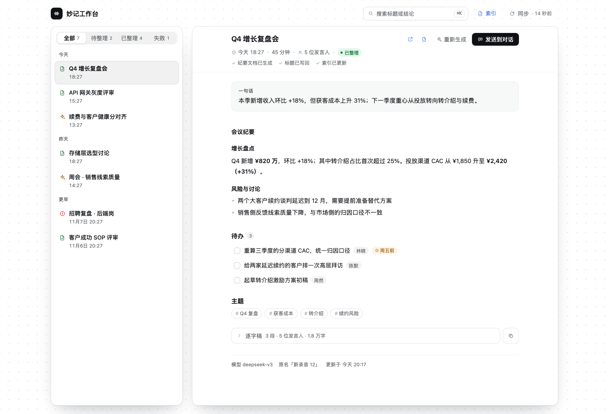

# 妙记工作台（dsh-lark-minutes-dashboard）

> 线上介绍页：<https://xianglifei.github.io/dsh-lark-minutes-dashboard/>



DSH Web 插件。把手机录的飞书妙记变成「能看懂标题 + 完整会议纪要 + 飞书文档 + 索引表」。版本变更见 [CHANGELOG.md](CHANGELOG.md)。

- 面板位置：左侧栏底部面板图标（声波图标），面板名「妙记工作台」
- 收件箱：显示最近 `searchWindowDays`（默认 7 天）内发现的全部妙记，外加已整理过的历史。后台每 60 秒去线上发现一次，一有新东西就通过本地 SSE 推给面板，面板不再自己定时轮询。不设「每页条数」，列表有多少就显示多少
- 自动整理：发现的妙记够格就**自己跑**（逐字稿 → LLM 生成标题/纪要 → 飞书文档 → 索引表加一行 → 标题写回），不用点按钮；够不上的留在「待整理」里等人点。判定见[自动整理](#自动整理)
- 长会议不截断：逐字稿超过 `chunkThresholdChars`（默认 2 万字）就分段总结再合并，正文按时间段覆盖到最后一个议题
- 索引文档：`妙记工作台 · 索引`，表格维护 `妙记链接 ↔ 纪要文档`；它同时是**跨设备的共享状态**，换机器后能直接认出「这条已经整理过」

## 自动整理

发现即入队。每轮同步（60 秒）结束时，后台串行消化队列：一次只跑一条，跑完再取下一条；跑的时间不会拖慢同步本身。

**什么时候自动跑**（四道闸门，任一不过就留在「待整理」）：

| 闸门 | 默认 | 作用 |
|---|---|---|
| `autoProcess` | `true` | 总开关。关掉就退回纯手动 |
| `autoProcessMinMinutes` | 3 分钟 | 挡住手机误触、语音备忘、几秒的测试录音 |
| `autoProcessSettleMinutes` | 5 分钟 | 沉淀期：刚录完转写还在跑，早处理会拿到残稿 |
| `autoProcessSkipKeywords` | `[]` | 标题命中关键词就不自动，如 `["面试", "1:1", "私密"]` |

另外，**只自动处理「启用这个版本之后新出现的妙记」**。升级当天不会把窗口里积压的历史欠账一次跑完（否则你会突然多出几十篇文档）；旧账还在「待整理」里，点一下照样能整理。

**转写没就绪怎么办**：按「时长 × 每分钟约 180 字」估一个期望字数，实际字数远低于期望就判定「还没转完」，退回队列等 5 / 15 分钟重试（共 `autoProcessMaxAttempts` 次），不会像以前那样直接落成终态的「已跳过」。只有纯几秒钟的录音才会被判「跳过」，并且写明时长。

**多设备**：不做主从。每台机器都可以跑，竞争只发生在**建文档之前**的那次收敛检查——按 token 读一次主索引文档，发现别的设备已经写过这条，就采纳它的文档指针、本地内容留作草稿，不再建第二篇。代价是多一次模型调用，换来的是「永远不会因为主设备不在手边而卡住」。

## 一句话检索

顶栏的输入框是「用一句话找妙记」，不是关键词搜索。标题和结论都是模型生成的，用户第一次见到那个措辞已经是在看列表之后了——**关键词搜索要求「回忆」，而这份内容只支持「识别」**。用一句自然语言描述你记得的那场会就行：

> 上周讲定价那场会，谁反对过折扣

- **它怎么工作**：Host 把窗口内的记录压成一份紧凑索引（标题 + 一句话 + 主题 + 时间/时长，约 100 字/条），整份交给模型挑最可能的 1–3 条并给出匹配理由。7 天窗口 ~70 条记录时，一次调用约 6k 输入 token。
- **只给候选，不给答案**：答案容易被当成事实，候选永远可核验。点候选就切到那条记录、打开详情。
- **不改动列表顺序**：左侧列表仍然按时间分组，搜索结果只是下拉里的提名。
- **回车才发**：一次 3–8 秒，边打字边搜会排一堆废请求；同一句话 60 秒内命中缓存。
- **模型编的 id 会被丢掉**：返回的候选必须原样出现在索引里，否则当作没找到——宁可告诉你没有，也不给一个点不开的结果。
- **输入框会向左长**：静息 248px，聚焦或已写超过 12 字时 420px。它左边是 `flex: 1` 的 spacer，加宽时 spacer 自动收缩，右边的「索引 / 同步」不动。
- **400 字上限？** 是 300 字，超过 120 字才显示计数。真要写长内容，「发送到对话」才是那条路。

## 界面

工作台是一张点阵画布：顶部一行只放全局动作，下面浮着两张卡片——左边竖卡是「收件箱」，右边矩形卡是「阅读器」。

- **画布双卡**：白底 + 22px 点阵；两张卡各 14px 小圆角、1px 发丝边、柔和阴影，中间留 22px 画布，不连成一张。浅色 / 深色都走 DSH token；深色下阴影几乎不可见，靠卡片 surface 与底色的亮度差和边框保持「浮起」。
- **顶部一行**：品牌、一句话检索、索引、同步直接落在画布上。索引入口只有一个——飞书索引文档，它同时是多设备共用的同步账本。登录正常时不显示任何身份信息，失效才在同步按钮旁出现红色「登录失效」，原因放 tooltip。
- **同步状态即按钮**：正常时是「同步 · 12 秒前」，秒数每 60 秒左右归零一次——用来证明后台真的在跑；超过 2 分钟没归零就退回「N 分钟前」（同步失败或机器休眠过），失败时变成红色的「重试同步 · 上次失败」。点它立刻重跑一次。不再把状态文字放在另一行，避免「有状态、没动作」。
- **Tab 在左卡里**：全部 / 待整理 / 已整理 / 失败 做成 macOS 分段控件，各自带数量，且 `待整理 + 已整理 + 失败 = 全部`（逐字稿太短被跳过的记录计入「待整理」，行上仍标注「已跳过」）。没有「每页条数」，看到的就是全部；列表里 `↑` `↓` 切换。
- **左卡列表**：两行行高约 54px。状态图标在最左，标题单行省略，时间在标题下一行；**时长只在详情头出现**，避免「几点几分 + 45 分钟」挤在一起看错。列表按「今天 / 昨天 / 更早」分组，组头 sticky；只有「更早」的行在行内补「11月7日」这类日期。一句话结论不占行，改为悬停提示（失败时悬停显示失败原因）。状态图标：已整理＝绿色「文档+对号」，待整理＝黄色，处理中＝黄色转圈，失败＝红色叹号，已跳过＝灰色。条目少时左卡下半部分留白，不在底部堆信息。
- **右卡详情**：标题 + 操作、元信息 + 状态、交付凭证一行绿色对号（纪要文档已生成 / 标题已写回 / 索引已更新）、「一句话」结论卡片、分节纪要、待办（可勾选、本地记忆）、主题、逐字稿。**妙记、纪要的跳转入口只保留在标题操作区**，不在页脚重复；内容结构没有变，只是换了卡片容器和排版。
- **发送到对话**：已整理的记录有一个主按钮「发送到对话」。点它会：① 现场补齐逐字稿（本机没有就调 lark-cli 拉一次）；② 把「会议总结」「逐字稿」写成两份 md；③ 新建一个会话，把两份 md 作为附件挂进去，并把提示词填进输入框（**不自动发送**，光标停在「然后我需要你：」后面）。原文、结论混在一起的问题就交给提示词解决：以逐字稿为准、冲突直接指出、引用发言人 + 时间戳。
- **空状态**：没有妙记时两张卡都保留——左卡给「立即同步」和「手机录音 → 自动整理 → 飞书文档」，右卡说明选中后会看到什么，不会缩成一张铺满屏幕的卡。
- **生成过程**：三步进度（读取逐字稿 → 生成标题与纪要 → 写入飞书文档与索引），处理中每 2.5 秒刷新真实阶段；可以切走，完成后自动更新。
- **失败不丢内容**：重新生成失败时保留上一次成功的纪要，只在上方提示原因，可重试；没有旧内容时，失败说明居中显示。
- **逐字稿**：按发言人分块、彩色头像、时间戳，首次渲染 80 段，可继续展开或一键复制。
- **字号与对比度**：正文 13–17、界面控件 10.5–13 两套尺；浅色下时间、元信息（含列表时间、tab 计数、页脚）用 text-2（≥4.5:1），caption 只做分隔点和装饰。
- **窄屏**：面板宽度小于 700px 时退回单栏——先看列表，点一条进入详情并出现返回按钮；卡片周围仍留一圈画布。700px 以上始终是左右两张卡。

## 安装

方式一：DSH 侧栏 **插件 → 添加插件**，输入包名（发布到 npm 后可用）：

```sh
dsh --profile desktop plugin add dsh-lark-minutes-dashboard
```

方式二：不发 npm，直接指向本仓库或本地目录（添加插件输入框也接受这两种写法）：

```sh
dsh --profile desktop plugin add git+https://github.com/xianglifei/dsh-lark-minutes-dashboard.git
dsh --profile desktop plugin add link:/absolute/path/to/dsh-lark-minutes-dashboard
```

装完刷新页面，左侧栏出现声波图标。

> 自带「添加插件」的输入框不是搜索框：它把输入当成 pnpm spec，用 `pnpm view` 去 registry 里解析。
> 只有已发布到 npm 的包名（或 git / tarball / 本地绝对路径）才会被认出来，见[发布](#发布)。

## 依赖

- `lark-cli` ≥ 1.0.99，且 user 身份已登录（`lark-cli auth status`）
- 文件类参数（`--output-dir` / `@file` / `--output`）只能落在 lark-cli 的白名单根目录里：**当前工作目录、`/tmp`、`~/files`**；相对路径也不能跳出 cwd（1.0.99 实测报错是 `is outside the built-in allowlist` / `resolves outside cwd`）。插件把所有 lark-cli 调用的 `cwd` 固定成 `/tmp/dsh-lark-minutes`，参数统一传相对路径（`transcripts`、`doc-xxx/doc.md`），本地读写再拼回绝对路径——这样无论线上版本是「白名单」还是「只认 cwd 内相对路径」，都不会踩坑。

## 数据

- 本地库：`$DSH_HOME/lark-minutes/store.json`（记录、状态、索引文档 token、索引快照）
- 对话导出：`$DSH_HOME/lark-minutes/exports/<妙记 token>/`（`… · 会议总结.md`、`… · 逐字稿.md`，重复点击同名覆盖；放数据目录而不是 `/tmp`，重启不丢）
- 排障日志：`$DSH_HOME/lark-minutes/client-trace.log`（「发送到对话」每一步：导出、建会话、挂附件、写草稿；超过 256KB 自动清空）
- 实例锁：`$DSH_HOME/lark-minutes/instance.lock`（同一台机器开多个 DSH 时，只有一个实例做发现与启动恢复）
- 逐字稿：`/tmp/dsh-lark-minutes/transcripts/`
- 待办勾选：浏览器 `localStorage`（`dsh-lark-minutes:todos:<token>`，只影响界面）
- 飞书侧：每条妙记一篇 `<标题> · 妙记纪要` 文档 + 一篇索引文档（多台机器共用同一份正本；历史重复的会自动收成「历史副本」）

## 多设备协同

索引文档就是跨机器的共享账本：表格里每一行是 `时间 | 标题 | 时长 | 妙记 | 纪要文档`。

- **发现已有索引**：每台机器每次刷新都做，不只是首次安装。① 先列云空间根目录清单——即时、可靠，刚建的文档立刻能看到；② 再把标题按分隔符拆成关键词做全文搜索——覆盖被移进子文件夹的老文档。两路取并集，结果按「去掉空白与分隔符后的标题」精确比对。**不能只靠搜索**：整串标题里的 `·` 会让 `docs +search` 直接返回 0 条，新文档也要过一阵才进搜索索引（实测 1 分钟仍为 0）。
- **主文档每台机器算出同一个**：按创建时间最早选主文档（同一秒按 token 排），合并所有拷贝里的行。不会因为「本机记住的是另一份」而各写各的。
- **采纳别的机器的成果**：每台机器每 5 分钟读一次索引，把「本机显示未生成、但云端已有纪要」的记录补上 `docUrl`、标题、时长和状态，直接变成「已整理」——换机 / 重装 / 清库后不会再假装没整理过。索引里有、本机从没发现过的妙记（例如超出搜索窗口）也会补进列表。采纳成功后会把主索引文档按合并后的行重写一遍，避免「面板说已整理、索引表里却没有这一行」。
- **重复索引自动收成「历史副本」**：发现多份时，先合并所有行，再把非主文档改名为 `妙记工作台 · 索引（历史副本）`，正文顶部留一条指向主索引的说明和一张当时的快照，之后不再写入；**不删除**用户文档。台面上只剩一份「正本」，不会再出现两份同名索引。
- **什么时候才会新建索引**：只有「根目录清单和全文搜索都跑通、且确实一份都没有」时才建。两条通道都失败会直接报错让你稍后重试，不会在搜索抖动时又造一份；即使并发撞车建出第二份，下一轮也会被合并进主文档并改名为历史副本。
- **正文自动回读**：点开这类记录时，Host 会用它自己的 `docToken` 把这篇飞书文档的 Markdown 拉回来，反解出标题 / 一句话 / 正文 / 待办，面板照常渲染（页脚标注「正文回读自飞书文档」），不需要你跳浏览器；10 分钟内走本地缓存。读失败（无权限、文档被删）才退化成「重新拉取 / 打开飞书文档」两个按钮。
- **逐字稿按需拉取**：索引文档只有「时间 / 标题 / 时长 / 妙记 / 纪要」五列，不搬逐字稿正文，所以别的设备整理的记录本机没有逐字稿。这类记录（以及本机 `/tmp` 被清掉的）在详情里展开「逐字稿」时会现场调一次 lark-cli 拉取并落盘，之后的渲染路径和本机整理的完全一致；不展开就完全不调用。
- **重建时合并**：写回索引时把「本地进度 + 云端还没采纳的行」一起写，两台机器不会互相删条目。

新索引文档的正文里带一行 `索引标识 妙记工作台索引账本`。发现时用它（或固定抬头、表格行）确认「这份同名文档确实是本插件的」——同名但不是本插件建的文档会被跳过，不会被覆盖。

## 接口（Host 半注册在 `/lark-minutes` 前缀下）

路由会先过 DSH 的 Host/Origin 与浏览器登录校验（`ctx.connection.requestRejection`），未登录、跨站或 DNS rebinding 的请求会被 401/403 拒绝；因此这些接口只供面板自身同源调用，终端 `curl` 不再能直接读。

```
GET  /lark-minutes/state                 认证状态、最后同步、索引文档、共享索引快照（`rev` 为变更版本号）
GET  /lark-minutes/events                SSE：库变了就推一个新 `rev`，面板据此决定要不要读
GET  /lark-minutes/list                  列表（窗口内全部；total + 各状态 counts）
GET  /lark-minutes/item?token=obcn...    详情（含逐字稿、model、updatedAt）
POST /lark-minutes/transcript {token}    按需拉逐字稿（本机没留存时现场调 lark-cli，落盘后返回）
POST /lark-minutes/sync                  立即同步一次
POST /lark-minutes/process {token}       生成纪要（建/更新文档 + 索引 + 标题写回）
POST /lark-minutes/search {q}            一句话检索（返回 1–3 条候选 + 匹配理由）
```

## 已知限制

- **时间窗口就是唯一的范围**：同步只查最近 `searchWindowDays` 天（默认 7 天；接口单次上限 1 个月，超过 30 天会自动每 30 天一片往前翻，每片用 `has_more` / `page_token` 翻页取全）。列表只展示「窗口内发现的 + 已整理过的（含其他设备）+ 处理中的」；窗口外又没整理过的旧记录不再展示，但仍留在本地库，把窗口调大就会回来。列表顺序用 `description` 里的「开始时间」解析，不依赖接口返回顺序。
- 「每页显示 N 篇」已经删掉：条数选择器对不上时间窗口，只会让数字看起来互相矛盾。
- 「发送到对话」依赖 DSH 客户端的会话/输入框服务（`uiWorkspace` / `conversation` / `fileUpload`）。这些接口在不同 DSH 版本间可能变动：取不到时会直接报错并说明原因，不会退化成「只塞进当前会话」或者静默少发附件。逐字稿拉不到时同样报错（例如几秒钟的空录音），不会悄悄只发总结。
- 只发现**我拥有的**妙记（`--owner-ids me`）；别人拥有、我只是参与的妙记不会进列表。
- **事件通道不可用**：`minutes.minute.generated_v1` 被 lark-cli 的 console 预检误判拦截（用户身份事件不出现在 `app_versions.event_infos`，见 larksuite/cli#2833），因此改为 60 秒轮询。注意这是**飞书侧**的事件；「Host 改了库 → 面板刷新」走的是本地 SSE（`/events`），不依赖飞书事件。
- **云文档搜索不可靠**：带 `·` 等分隔符的整串标题会让 `docs +search` 返回 0 条结果（v0.3.0 的「按标题搜索引文档」正是踩了这个坑，导致多设备同步静默失效）；新文档也有进索引的延迟。所以索引发现改成「云空间根目录清单 + 关键词搜索」双路，不能只依赖一次搜索。
- **索引读是节流的**：后台每 5 分钟读一次云端索引；面板开着（有 SSE 连接）时降到 `foregroundRefreshSec`（默认 60 秒），这样「另一台刚整理完」不用等满 5 分钟。索引的**写**不是定时的，只在生成完一条或采纳了别的设备的行之后发生。
- **别给索引文档改名**：标题是发现的主要依据（比较时会忽略空白和 `·` 等分隔符，但字不能变）。改名后只有「本地记得 token」的机器还能读到它，全新设备可能找不到并新建一份——下一轮会把旧的收成历史副本、行也合并不丢，但会多一次合并。移进子文件夹还能靠全文搜索兜底（有延迟）。
- 标题写回前会先读远端当前标题：只有「原标题是默认名（新录音 N 等）」或「当前标题仍是上次我们写的那个」时才写回，用户在飞书里改过的名字不会被覆盖。
- DSH 退出或插件重载时，停在「读取逐字稿 / 生成纪要 / 写入文档」的记录会在下次启动时转成「处理失败」，可直接重试；不会永远转圈。**自动整理中的记录例外**：它会被重排回「待整理」，等下一轮接着跑（同一条累计跑满 5 次还是中断，才落成失败，防止一跑就崩的记录无限重来）。自动跑是真的在后台跑，真失败不会弹通知，要看面板的「失败」计数。
- **自动整理不会自己重试真失败**（`autoRetryFailed` 默认 `false`）：权限、模型、写入这类问题重试只会连着烧钱。转写没就绪是唯一的例外，它会按 `autoProcessRetryMinutes` 退避重试。
- **分段总结的成本是线性增长的**：超过 `chunkThresholdChars` 的录音按块收费（3 小时会议约 8–10 块 + 1 次合并）。短会议不受影响，仍是一次调用。
- **分段总结里某一块失败不会让整条记录失败**：该节会写「本节生成失败：原因」，其余照常。只有全部块都失败才算这条记录失败。
- 多设备同时开着时，同一条新妙记可能有多台设备各自调用一次模型；先完成的那台写进索引，其余设备采纳它的文档、本地内容留作草稿，**云盘里仍然只有一篇文档**。这是有意的取舍：多花一次调用，换「永远不会因为主设备不在手边而卡住」。
- 模型调用有总超时（`llmTimeoutMs`，默认 180 秒），超时会记为失败并保留上一次成功的正文。
- 重新生成会**覆盖**同一篇纪要文档，不会产生第二篇。
- 纪要用的是 DSH 当前默认模型的 provider/model（`agentDefaultModel`），可在设置里换模型；**推理档位默认不跟随全局设置**（`reasoningEffort` 留空 = 模型默认档），避免给批量整理套上高推理档导致又慢又贵，需要时用配置覆盖。输出上限 `maxTokens` 默认 8000（分段总结时每一块单独限 4000，合并那一次用 `maxTokens`）。逐字稿**不再截断**：超过 2 万字走分段 map-reduce，正文由代码按时间段拼接，长度不受单次输出上限约束。
- 单实例写锁只覆盖「发现」和「启动恢复」；同一台机器开两个 DSH 时，另一个实例会跟随磁盘状态，但**手动处理**仍可能与持锁实例并发（不会重复建文档，因为文档 token 会被采纳）。
- `GET /list` 的 `counts` 与 `GET /item` 的 `model` / `updatedAt` 是 v0.2 新增的 Host 字段；`item.adoptedAt`（纪要是别的设备做的）、`GET /item` 的 `generated.fromDoc` / `hydrateError`（正文回读自文档，以及回读失败原因）与 `state.lastWarning`（部分时间窗读取失败）是 v0.3 新增；`state.shared.documents`（本机读到的全部索引文档）、`state.shared.retired`（已合并成历史副本的 token）与 `state.shared.discoveryOk`（两条发现通道是否可用）是 v0.4 新增。旧进程里缺这些字段时界面会自动退化，不影响使用。

## 发布

插件要能被别人在「添加插件」里输入名字直接找到，必须发布到 npm 公共 registry。
`package.json` 已具备发布条件（声明了 `dsh.bundle.patch`、`files` 含全部运行文件、去掉了 `private`）：

```sh
npm login
npm publish            # 未 scope 的包默认 public；首次发布前确认版本号
npm view dsh-lark-minutes-dashboard version   # 确认 registry 已可读
```

发布后，别人在「添加插件」里输入 `dsh-lark-minutes-dashboard` 即可解析到最新版本；
维护期间改版本号后重新 `npm publish` 即可，用户端在插件详情里会看到可更新版本。

> pnpm 的 `minimumReleaseAge` 供应链策略可能让刚发布的版本暂不可装，
> 此时安装对话框会提示实际装到的版本，等一段时间或按提示安装精确版本即可。

## 结构

| 文件 | 作用 |
|---|---|
| `index.js` | Host 半：轮询发现、调 lark-cli、LLM 总结、文档/索引维护、HTTP 路由 |
| `client.js` | Client 半：`sidebar.panellist` 图标 + `main` 面板；样式以受控 `<style>` 注入，全部使用 DSH token |
| `cordis.patch.yml` | 插件行与默认配置 |
| `locale/*.json` | 插件管理器里的标题与描述 |
